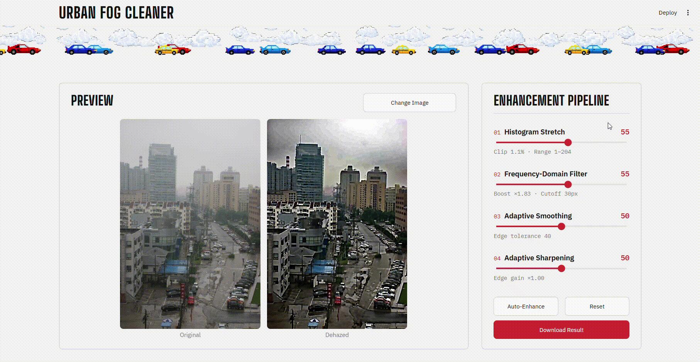

<div align="center">

# Urban Fog Cleaner ( Dehaze App )

**Upload a foggy city photo, tune a four-stage enhancement pipeline, and download a clear result.**

[](https://dehazeapp.streamlit.app/)


[](assets/Preview/Screen%20Recording%202026-10-15%20123729.mp4)

<sub>▶ Click the preview to watch the full screen recording.</sub>

</div>

---

## Overview

**Urban Fog Cleaner** is a Streamlit web app that restores visibility in foggy and hazy urban photos (buildings, roads, vehicles). It was built as a Digital Image Processing course project.

Fog removal runs first using the **Dark Channel Prior**, then three tunable enhancement filters refine the result. Every slider has a live readout, and the original and dehazed images are shown side by side.

**Where this helps:** traffic monitoring, construction inspection, and any scene where poor visibility hides structure.

## Live demo

👉 **https://dehazeapp.streamlit.app/**

## Demo video

A full screen recording of the app in action is in [`assets/Preview`](assets/Preview/Screen%20Recording%202026-10-15%20123729.mp4).

<video src="assets/Preview/Screen%20Recording%202026-10-15%20123729.mp4" controls muted width="100%"></video>

## Features

- Drag-and-drop upload of foggy photos (JPG, PNG, WebP, GIF, BMP, TIFF, AVIF and more; HEIC with an optional extra)
- Original vs. dehazed preview, large and side by side
- Four sliders (0–100) with live readouts of what each stage is doing
- **Auto-Enhance** and **Reset** buttons
- One-click **Download Result** as PNG
- Handles EXIF rotation, transparency, 16-bit/float images and CMYK/grayscale files
- Friendly error messages for unreadable files
- Pixel-art header strip of cars and clouds animated across the page

## How it works

The pipeline in `dehaze_app.py` runs in this order:

| Step | Stage | What it does |
|------|-------|--------------|
| 1 | **Dark Channel Prior** (always on) | Estimates the airlight and a per-pixel transmission map, refined with a **guided filter** so it follows real edges, then recovers the haze-free scene `J = (I − A) / t + A` |
| 2 | **Adaptive Smoothing** | Edge-preserving bilateral filter; smooths flat areas and the noise fog removal amplifies, keeps edges |
| 3 | **Adaptive Sharpening** | Unsharp mask on luminance with the added detail capped, so strong edges don't overshoot into halos |
| 4 | **Histogram Stretch** | Linear contrast stretch of luminance, clipping 0–2 % from each end |
| 5 | **Frequency-Domain Filter** | FFT high-frequency emphasis with a smooth Gaussian high-pass (no ringing) and mirror padding (no border wrap-around) |

**Design notes**

- Stages 2–5 work on **luminance only** (the Y channel of YCrCb). Processing R, G and B separately shifts hues and paints coloured noise.
- Every stage returns its input untouched when its slider is at `0`, so **Reset** switches all three filters off. The dark-channel step is the app's base and always runs.
- Images larger than **1200 px** on the long edge are downscaled before processing.

## Run locally

```bash
git clone https://github.com/ZannatulRaian/Dehaze-App.git
cd Dehaze-App

python -m venv .venv
# Windows: .venv\Scripts\activate
# macOS/Linux: source .venv/bin/activate

pip install -r requirements.txt
streamlit run dehaze_app.py
```

The app opens at `http://localhost:8501`.

**Optional:** to open iPhone HEIC/HEIF photos, run `pip install pillow-heif`.

## Project structure

```
Dehaze-App/
├── dehaze_app.py          # Streamlit app + the full dehazing pipeline
├── requirements.txt       # Python dependencies
├── .streamlit/
│   └── config.toml        # Streamlit theme/config
└── assets/
    ├── cars/              # Pixel-art car sprites (header strip)
    ├── clouds/            # Pixel-art cloud sprites (header strip)
    ├── test images/       # Sample hazy photos to try the app with
    └── Preview/           # Demo recording (preview.gif + full .mp4 recording)
```

## Try it with the sample images

`assets/test images/` includes ready-to-use hazy photos:

- `city_smog/` – smoggy city streets and a foggy park
- `outdoor_fog_with_clear_reference/` – hazy scenes, each paired with a clear reference photo to compare against

## Tech stack

[Streamlit](https://streamlit.io/) · [OpenCV](https://opencv.org/) (headless) · [NumPy](https://numpy.org/) · [SciPy](https://scipy.org/) · [Pillow](https://python-pillow.org/)

## References

- K. He, J. Sun, X. Tang, *Single Image Haze Removal Using Dark Channel Prior*, CVPR 2009
- K. He, J. Sun, X. Tang, *Guided Image Filtering*, ECCV 2010

## Author

**Zannatul Raian** · [@ZannatulRaian](https://github.com/ZannatulRaian)
