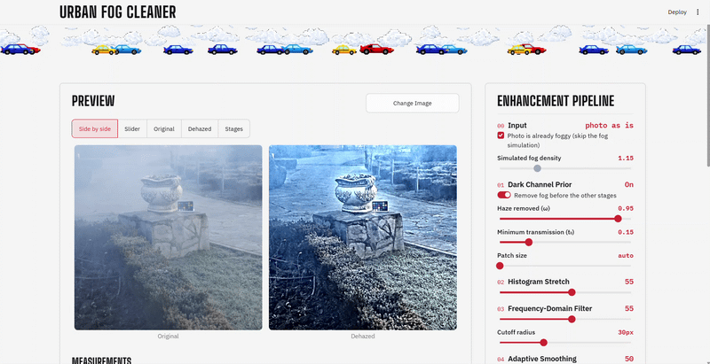

<div align="center">

# Dehaze App

**Upload a foggy city photo, tune an enhancement pipeline built on frequency-domain enhancement, histogram stretching and adaptive smoothing and sharpening, check the result with measurements, and download it.**

[](https://dehazeapp.streamlit.app/)


</div>

---

## 📷 Main View



---

## Overview

**Dehaze App** is a Streamlit web app that makes buildings, roads and vehicles more visible in foggy or blurred urban photos. It was built as a Digital Image Processing course project (*Project 7*).

The project asks for three modules, and all three are implemented as separate stages with their own controls:

| Project requirement | Where it is in the app |
| --- | --- |
| Frequency-domain enhancement (edge sharpening) | Stage 04: FFT high-frequency emphasis with a Gaussian high-pass |
| Histogram stretching | Stage 03: percentile stretch of luminance |
| Adaptive smoothing and sharpening | Stages 05 and 06: edge-preserving smoothing, then capped unsharp masking |
| Simulate foggy images | Input stage: fog from the atmospheric scattering model, plus optional Gaussian or motion blur |
| Or use real ones | Upload any photo (tick *Photo is already foggy*); the bundled outdoor test photos come with clear references that `evaluate.py` uses |
| Make urban structures more visible | **Edges** view, edge-pixel and gradient measurements, Canny edge and Hough line counts, before/after histograms |
| Blurred or foggy view | Fog removal (dark channel prior) and Wiener deblurring with automatic blur-size estimation (stage 02) |
| Traffic monitoring, construction inspection | **Batch Processing** card: many photos at once, time per photo, ZIP download |

The **Course modules only** switch runs just the three project modules, so their effect can be shown on its own. The **Dark Channel Prior** and the optional **Wiener deblur** are additions that handle fog and blur, which the three modules alone cannot remove.

## Live demo

👉 **https://dehazeapp.streamlit.app/** (this may show an older version until it is redeployed from this code)

## What is in the app

Everything is on the main page (no sidebar), under the pixel-art header strip.

**Preview card** (left)
- Upload a photo by dropping it on the box. **Change Image** starts over.
- **View** switch:
  - **Side by side** — original and dehazed.
  - **Slider** — one image with a divider you drag between original (left) and dehazed (right).
  - **Original** and **Dehazed** — one image at a time.
  - **Stages** — steps through the pipeline in the order it runs. *Cumulative* shows the image before and after the stage you pick; *This stage only* shows the original next to the original with just that stage applied.
  - **Edges** — the Sobel gradient of the original and the dehazed image on one shared scale, so you can see how much more of the buildings and roads shows up.
- **Measurements**: contrast, entropy, mean gradient, edge pixels, processing time, how many edges a standard Canny detector finds and how many building (vertical) and lane (oblique) lines a Hough line detector finds, and, when fog or blur is simulated on a clear photo (that photo is the reference), PSNR, SSIM, edge F1 and line recall against it, plus brightness and R, G, B histogram comparisons.
- The card stays in view while you scroll the pipeline controls.

**Enhancement Pipeline card** (right)
- **00 Input** — *Photo is already foggy*, simulated fog density, simulated blur (Gaussian or horizontal motion), and the **Course modules only** switch.
- **01 Dark Channel Prior** — on/off, haze removed (ω), minimum transmission (t₀), patch size.
- **02 Deblur (Wiener)** — blur to undo (0 = off), assumed blur type, noise damping, or **Detect the blur automatically**, which measures the blur type and size from the photo and shows what it found.
- **03 Histogram Stretch**, **04 Frequency-Domain Filter** (strength and cutoff radius), **05 Adaptive Smoothing**, **06 Adaptive Sharpening**.
- **07 Final Tone** — gamma, saturation and a gray-world colour balance.
- **Preset** (Balanced, Light haze, Dense fog, Maximum detail, Fog removal only, Course modules only), **Auto-Enhance**, **Reset**, **Download Result**.

**Batch Processing** (below): upload several photos, process them with the current settings, see time and contrast per photo, and download everything as a ZIP with a CSV of the results.

**Method** (bottom): the fog model, the approach and the references.

## How it works

The pipeline (in `dehaze_core.py`) runs in this order; the numbers in brackets are the stage numbers shown in the app:

| Step | Stage | What it does |
| ---- | ----- | ------------ |
| 1 | **Dark Channel Prior** [01] (on by default) | Estimates the airlight and a per-pixel transmission map, refined with a **guided filter** so it follows real edges, then recovers the haze-free scene `J = (I − A) / t + A` |
| 2 | **Deblur (Wiener)** [02] (off at 0) | Wiener deconvolution of luminance in the Fourier domain for a Gaussian or horizontal motion blur whose size you set or that `estimate_blur` measures; mirror padding and a noise-damping term limit ringing |
| 3 | **Adaptive Smoothing** [05] | Edge-preserving bilateral filter; smooths flat areas and the noise fog removal amplifies, keeps edges |
| 4 | **Adaptive Sharpening** [06] | Unsharp mask on luminance with the added detail capped, so strong edges don't overshoot into halos |
| 5 | **Histogram Stretch** [03] | Linear contrast stretch of luminance, clipping 0–2 % from each end |
| 6 | **Frequency-Domain Filter** [04] | FFT high-frequency emphasis with a smooth Gaussian high-pass (no ringing) and mirror padding (no border wrap-around) |
| 7 | **Final Tone** [07] | Optional gray-world colour balance, saturation and gamma |

**Design notes**

- Stages 2–6 work on **luminance only** (the Y channel of YCrCb). Processing R, G and B separately shifts hues and paints coloured noise.
- Every stage returns its input untouched when it is switched off or its strength is `0`, so **Reset** switches the four filters and the deblur off and puts the tone controls back to neutral. **Course modules only** switches off the dark channel, deblur and tone stages without touching their settings.
- **Blur estimation** (`estimate_blur`): the width of the strongest edges is measured across and along the image (the std of the edge's gradient profile, which equals the blur kernel's std). A sharp photo's own edge width is subtracted in quadrature; equal excess in both directions is Gaussian blur, excess in one direction only is motion blur (box length = 3 x amount). Fog scales an edge's step and its gradient by the same factor, so the estimate does not depend on fog density.
- Images larger than **1200 px** on the long edge are downscaled before processing.
- The image-processing code is in `dehaze_core.py` (no Streamlit), so it can be tested and evaluated on its own.

## Default settings and evaluation

The first version of the defaults over-processed: on the seven real foggy test scenes it scored **worse than doing nothing** on structural similarity (SSIM 0.58 against 0.69 for the untouched photo). The defaults were then chosen by a random parameter search on four of the scenes, with the three course modules required to stay active, the tone stage kept neutral apart from a mild colour balance, and a minimum contrast and edge gain required. They kept their advantage on the three scenes left out of the search. The same search with only the three modules allowed gives the **Course modules only** preset. The other presets are hand-set around the default.

`python evaluate.py` re-runs the experiments and writes `results/` (CSV files, `summary.md`, comparison images). Each method is an ablation, measured against the clear photo of each scene; values are means over the 7 scenes at up to 800 px. Further down: an urban test with a true depth map, a downstream edge and line detection test, and a check of the blur estimator.

**Real fog** (7 hazy photos with clear references)

| Method | PSNR (dB) | SSIM | Contrast x | Edge pixels (%) | Seconds/image |
| --- | ---: | ---: | ---: | ---: | ---: |
| Foggy input (no processing) | 13.7 | 0.674 | 1.00 | 13.0 | 0.00 |
| Histogram stretching only | 12.1 | 0.701 | 2.43 | 35.4 | 0.01 |
| Frequency-domain enhancement only | 13.8 | 0.739 | 1.08 | 25.7 | 0.05 |
| Adaptive smoothing + sharpening only | 13.7 | 0.602 | 1.01 | 8.3 | 0.04 |
| The three course modules together | 13.7 | 0.684 | 2.07 | 30.8 | 0.08 |
| Dark channel prior only | 17.0 | 0.769 | 1.17 | 22.7 | 0.09 |
| Full pipeline (Balanced default) | 15.9 | 0.706 | 2.03 | 34.6 | 0.10 |

**Simulated fog** (the 7 clear photos, fogged with β = 1.6)

| Method | PSNR (dB) | SSIM | Contrast x | Edge pixels (%) | Seconds/image |
| --- | ---: | ---: | ---: | ---: | ---: |
| Foggy input (no processing) | 10.2 | 0.657 | 1.00 | 15.5 | 0.00 |
| Histogram stretching only | 10.5 | 0.765 | 2.25 | 37.4 | 0.01 |
| Frequency-domain enhancement only | 10.2 | 0.732 | 1.07 | 29.4 | 0.05 |
| Adaptive smoothing + sharpening only | 10.2 | 0.569 | 1.01 | 9.9 | 0.05 |
| The three course modules together | 11.0 | 0.694 | 1.99 | 34.2 | 0.09 |
| Dark channel prior only | 21.5 | 0.943 | 1.25 | 36.0 | 0.10 |
| Full pipeline (Balanced default) | 18.0 | 0.805 | 1.91 | 47.0 | 0.11 |

**Simulated fog + horizontal motion blur** (2 px)

| Method | PSNR (dB) | SSIM | Contrast x | Edge pixels (%) | Seconds/image |
| --- | ---: | ---: | ---: | ---: | ---: |
| Foggy input (no processing) | 10.1 | 0.478 | 1.00 | 3.0 | 0.00 |
| Histogram stretching only | 10.3 | 0.564 | 2.37 | 17.0 | 0.01 |
| Frequency-domain enhancement only | 10.1 | 0.519 | 1.03 | 9.1 | 0.04 |
| Adaptive smoothing + sharpening only | 10.1 | 0.444 | 1.00 | 1.9 | 0.04 |
| The three course modules together | 10.7 | 0.555 | 2.14 | 16.8 | 0.08 |
| Dark channel prior only | 19.9 | 0.681 | 1.24 | 13.3 | 0.09 |
| Full pipeline (Balanced default) | 17.2 | 0.655 | 1.92 | 25.7 | 0.10 |
| Full pipeline + Wiener deblur (blur known) | 17.9 | 0.782 | 1.93 | 44.4 | 0.10 |
| Full pipeline + Wiener deblur (blur estimated) | 17.6 | 0.738 | 1.92 | 44.3 | 0.12 |

### Urban test: synthetic city streets with a true depth map

`assets/test images/urban_synthetic/` holds 6 synthetic city streets (640 x 400: building rows, windows, cars, lane lines), each as `cityNN_clear_reference.png`, `cityNN_hazy.png` (fogged with β = 1.6) and `cityNN_depth.png` (true depth, 16-bit, 0 = near, 1 = far). Fog is simulated with the true depth, so the clear scene and the true transmission are both known. `python evaluate.py --export-urban` rewrites the set; the layouts come from `make_urban_set()`.

| Method (urban set, β = 1.6) | PSNR (dB) | SSIM | Contrast x | Edge pixels (%) |
| --- | ---: | ---: | ---: | ---: |
| Foggy input (no processing) | 12.2 | 0.754 | 1.00 | 6.9 |
| The three course modules together | 12.2 | 0.696 | 1.31 | 24.7 |
| Dark channel prior only | 21.8 | 0.871 | 1.08 | 7.1 |
| Full pipeline (Balanced default) | 19.4 | 0.793 | 1.29 | 16.4 |

Across fog densities (full pipeline against doing nothing, SSIM): β 0.8 **0.875 → 0.746**, β 1.6 0.754 → 0.793, β 2.4 0.668 → 0.787, β 3.2 0.605 → 0.770. So the Balanced default is tuned for dense fog and **over-processes light haze**; use the *Light haze* preset or *Fog removal only* there.

With the true depth the dark channel's transmission map can be checked directly: its correlation with the true transmission is 0.91 to 0.96 (mean absolute error 0.06 to 0.09) and its airlight is within about 6 of 255 grey levels of the true one, over β 0.8 to 3.2.

### Downstream test: edges and lines before and after

A standard Canny edge detector (fixed thresholds 50/150) and a probabilistic Hough line detector are run on each result and compared with what they find in the clear photo: **edge F1** (2 px tolerance), **line recall** (share of the clear photo's lines found again), and counts of building (near-vertical) and lane (oblique) lines. A second F1 uses Canny thresholds set from each image's median brightness, which compensates for fog's low contrast, so it shows gain beyond "the picture is just more contrasty".

| Method | Canny edges (% px) | Edge F1 | Edge F1, auto thresholds | Hough lines | Line recall |
| --- | ---: | ---: | ---: | ---: | ---: |
| **Real fog (7 scenes)** | | | | | |
| Foggy input | 0.4 | 0.155 | 0.078 | 6 | 0.039 |
| The three course modules together | 7.8 | 0.661 | 0.717 | 642 | 0.513 |
| Dark channel prior only | 1.7 | 0.441 | 0.678 | 53 | 0.150 |
| Full pipeline (Balanced default) | 9.4 | 0.645 | 0.723 | 763 | 0.551 |
| **Urban set, β = 1.6 (6 scenes)** | | | | | |
| Foggy input | 4.5 | 0.836 | 0.815 | 86 | 0.534 |
| The three course modules together | 5.8 | 0.930 | 0.950 | 123 | 0.771 |
| Dark channel prior only | 5.8 | 0.943 | 0.965 | 134 | 0.803 |
| Full pipeline (Balanced default) | 5.9 | 0.938 | 0.939 | 126 | 0.771 |

On real fog the standard detectors find almost nothing in the foggy photo (0.4 % edge pixels, 6 lines) and a lot after processing, and edge F1 improves in all 7 scenes for every method. On the synthetic streets, fog at β 1.6 still leaves most edges findable, so the gain is smaller (F1 0.84 → 0.94, line recall 0.53 → 0.77) and the dark channel alone does as well as the full pipeline. Read counts with care: more lines is not better by itself, and the real scenes' line counts are mostly grass and gravel texture (see `results/figures/downstream_lines_real.png`), which is why F1 and recall are the numbers to compare. The `summary.md` tables also split the building and lane counts and repeat this for every blur condition.

### Blur estimation

`estimate_blur` was checked on photos blurred by a known amount (fog added first). The Gaussian calibration factor (1.15) was fit on the 7 real photos only, so the synthetic cities are an independent check.

| True blur | Real photos: estimate (px) | Synthetic cities: estimate (px) |
| --- | ---: | ---: |
| none (sharp), fog β 0, 1.6 and 3 | 0.00 (all called sharp) | 0.00 (all called sharp) |
| Gaussian 1 / 2 / 3 / 4 px | 0.81 / 1.97 / 3.07 / 3.95 | 1.18 / 1.98 / 2.68 / 3.50 |
| Motion 1 / 2 / 3 / 4 px | 0.25 / 2.09 / 2.65 / 3.48 | 0.93 / 1.71 / 2.20 / 3.29 |

The blur type was right in every case from 2 px up, at both fog densities tested (β 1.6 and 3), and no sharp photo was called blurred. Errors grow with blur size (about 0.2 px at 2 px, 0.5 to 0.7 px at 4 px). Blur of about 1 px is at the limit: Gaussian 1 px was found in 6 of 7 real photos and horizontal motion 1 px in only 2 of 7. Using the estimate instead of the true blur keeps most of the gain on the real photos: with simulated fog + motion blur SSIM is 0.738, against 0.782 with the true blur and 0.655 with no deblur (about two thirds of the gain); with Gaussian blur it is 0.666 against 0.670 and 0.578 with no deblur. On the 7 real hazy photos, which have no known blur, the estimator found none, and on the other bundled photos it also called all of them sharp.

What the numbers show:

- The **three course modules** clearly make structure more visible: contrast roughly doubles and edge pixels go from about 13 % to 31 % on real fog. Used alone they barely improve PSNR (13.7 dB, the same as the foggy photo) and SSIM only slightly (0.684 against 0.674), because they cannot remove the haze itself.
- **Histogram stretching** and **frequency-domain enhancement** each improve SSIM on their own. **Adaptive smoothing + sharpening** on its own does not (SSIM 0.602 against 0.674, and fewer edge pixels), so it is best used together with the other stages.
- The **dark channel prior** does most of the work for fidelity: PSNR 13.7 → 17.0 dB on real fog and 10.2 → 21.5 dB on simulated fog. Adding the three modules to it lowers PSNR and SSIM a little but raises contrast and edge pixels, which is the trade-off the *Balanced* default and the **Fog removal only** preset let you choose between.
- **Wiener deblurring** helps: with motion blur, SSIM rises from 0.655 to 0.782 (blur known) or 0.738 (blur estimated by the app) and PSNR from 17.2 to 17.9 dB (known) or 17.6 dB (estimated). On the synthetic streets it changes little (SSIM 0.754 to 0.756 with motion blur, PSNR slightly lower) because their edges are already clean.
- A full pipeline run takes about **0.1 s per 800 px photo** on the CPU of the machine used for the evaluation, with no GPU.

**Limitations**

- The seven real scenes with clear references are gardens, parks and playgrounds, not city streets, and the defaults were tuned on a subset of them, so the numbers are indicative, not a benchmark.
- The urban test set is synthetic: clean flat-coloured renders with a made-up depth map. It gives exact ground truth, but it flatters edge detection and does not replace real street photos. To test on real ones, put `name_hazy.jpg` and `name_clear_reference.jpg` pairs in `assets/test images/urban_with_clear_reference/`; `python evaluate.py` then adds a section for them (`results/street_photos.csv`). No such pairs are bundled.
- PSNR and SSIM measure similarity to the clear photo, not how visible structures look to a person; contrast and edge measures rise with over-sharpening too. Judge the pictures as well.
- Blur estimation covers uniform Gaussian and horizontal motion blur only. It reads blur under about 1 px as sharp, under-reads large blur (about 0.5 px low at 4 px on the synthetic streets), and detects vertical motion blur without being able to undo it. Camera shake in other directions, defocus with a disc-shaped kernel and blur that varies across the frame are not handled. The sharp-photo baseline (0.65 px) was measured on the bundled photos at about 800 to 1200 px; a differently resized or heavily compressed photo may read as slightly blurred or sharp.
- The edge and line test uses one detector setting (Canny 50/150, Hough threshold 50, minimum length 30 px); another setting would give other counts, though the comparison with the clear photo is what matters.
- Fog simulated on a photo uses a rough depth guess (farther toward the top of the frame).
- Single images and batches only: no video, and no detection of buildings, roads or vehicles.

## Run locally

```bash
git clone https://github.com/ZannatulRaian/Dehaze-App.git
cd Dehaze-App

python -m venv .venv
# Windows: .venv\Scripts\activate
# macOS/Linux: source .venv/bin/activate

pip install -r requirements.txt
streamlit run dehaze_app.py
```

The app opens at `http://localhost:8501`.

```bash
python evaluate.py    # re-run the evaluation, writes ./results (about 40 s)
python evaluate.py --export-urban   # also rewrite the synthetic city test set in assets/
python test_core.py   # quick checks of the image-processing code
```

**Optional:** to open iPhone HEIC/HEIF photos, run `pip install pillow-heif`.

## Project structure

```
Dehaze-App/
├── dehaze_app.py          # Streamlit app (layout, controls, views, batch)
├── dehaze_core.py         # Image processing: stages, fog/blur simulation, blur estimation, metrics (no Streamlit)
├── evaluate.py            # Ablation, urban, edge/line and blur-estimation experiments -> results/
├── test_core.py           # Checks for the core
├── results/               # Evaluation output: CSV files, summary.md, comparison images
├── requirements.txt       # Python dependencies
├── .streamlit/
│   └── config.toml        # Streamlit theme/config
└── assets/
    ├── cars/              # Pixel-art car sprites (header strip)
    ├── clouds/            # Pixel-art cloud sprites (header strip)
    ├── test images/       # Sample hazy photos to upload and try
    │   └── urban_synthetic/   # 6 synthetic city streets: clear, hazy (β 1.6) and true depth map
    └── Preview/           # Demo recording (preview.gif + full .mp4 recording)
```

## Try it with the sample images

`assets/test images/` includes ready-to-use hazy photos. Drop any of them on the upload box:

- `city_smog/` – smoggy city streets and a foggy park
- `outdoor_fog_with_clear_reference/` – hazy scenes, each paired with a clear reference photo; `evaluate.py` measures them against their references
- `urban_synthetic/` – synthetic city streets with a clear version and a true depth map (`_hazy`, `_clear_reference`, `_depth`); `evaluate.py` uses the depth to simulate fog at other densities

## Tech stack

[Streamlit](https://streamlit.io/) · [OpenCV](https://opencv.org/) (headless) · [NumPy](https://numpy.org/) · [SciPy](https://scipy.org/) · [Pillow](https://python-pillow.org/)

## References

- K. He, J. Sun, X. Tang, *Single Image Haze Removal Using Dark Channel Prior*, CVPR 2009 (IEEE TPAMI 2011)
- K. He, J. Sun, X. Tang, *Guided Image Filtering*, ECCV 2010 (IEEE TPAMI 2013)
- S. G. Narasimhan, S. K. Nayar, *Vision and the Atmosphere*, IJCV 2002
- H. Koschmieder, *Theorie der horizontalen Sichtweite*, 1924
- R. C. Gonzalez, R. E. Woods, *Digital Image Processing*, 4th ed., Pearson, 2018
- C. Tomasi, R. Manduchi, *Bilateral Filtering for Gray and Color Images*, ICCV 1998
- Z. Wang et al., *Image Quality Assessment: From Error Visibility to Structural Similarity*, IEEE TIP 2004

## Author

**Zannatul Raian** · [@ZannatulRaian](https://github.com/ZannatulRaian)
